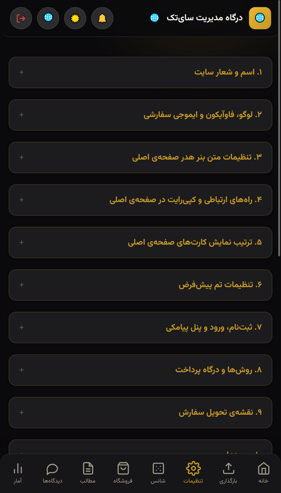
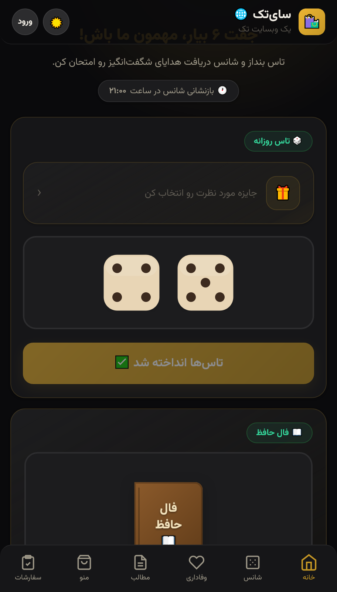

<div align="center">

# 🛍️ سای‌تک | SiTak Platform

**پلتفرم مدرن، سبک، ماژولار و جامع فروشگاهی، محتوایی و گیمیفیکیشن بر پایه Native PHP 8+ و Vanilla JS**

[](https://www.php.net/)
[](https://www.mysql.com/)
[](https://developer.mozilla.org/)
[](https://developer.mozilla.org/en-US/docs/Web/API/Web_Audio_API)
[](https://datatracker.ietf.org/doc/html/rfc8291)
[](LICENSE)
[](#-توسعه-با-همراهی-هوش-مصنوعی)


[**🇮🇷 مستندات فارسی**](#-معرفی-کلی-سامانه) • [**🇬🇧 English Documentation**](#-english-documentation)

<p align="center">
  
  &nbsp;&nbsp;&nbsp;&nbsp;
  
</p>

</div>

---

## 📌 جدول مشخصات و معماری (Quick Specs)

| ویژگی | توضیحات و وضعیت فنی در سورس پروژه |
| :--- | :--- |
| **هسته بک‌اند** | Pure / Native PHP 8.0+ مستقل، بدون Composer، بدون فریم‌ورک‌های سنگین و کم‌مصرف در منابع سرور |
| **پایگاه داده** | MySQL 5.7+ / MariaDB 10.3+ با موتور مایگریشن خودکار (`schema_migrations` و قفل رقابتی `GET_LOCK`) |
| **رابط کاربری و ظاهر** | طراحی موبایل‌محور (Mobile-First)، سبک شبه‌اپلیکیشن (Native App-Like)، برگه کشویی پایین (Bottom Sheet)، قلم محلی وزیرمتن |
| **حالت تاریک و روشن** | پشتیبانی ۳ حالته (Dark / Light / Auto بر اساس سیستم‌عامل) بدون پرش تصویر (Anti-Flicker Script) |
| **سیستم‌های چندرسانه‌ای** | سنتز procedural اصوات با **Web Audio API** (بدون فایل صوتی خارجی) و صدور فاکتور با **HTML5 Canvas** |
| **درگاه و تسویه مالی** | درگاه مستقیم زرین‌پال v4، سامانه هوشمند کارت‌به‌کارت با تایمر رزرو انبار، و تسویه هماهنگ‌شده |
| **پیامک و ارتباطات** | اتصال به سرویس UltraFast پیامک خدماتی SMS.ir با الگوهای اعتبارسنجی OTP و ارسال وضعیت |
| **اعلان‌های زنده** | اعلان‌های مرورگری Web Push مبتنی بر استاندارد VAPID (RFC 8291/8292) همراه با Polling رویدادهای زنده |
| **امنیت و محافظت** | فایروال نرم‌افزاری، تله ضدبات (Honeypot)، محافظت نرخ درخواست (Rate Limiting) و ابزار مستقل Emergency |

---

## 📖 فهرست مطالب
- [معرفی کلی سامانه](#-معرفی-کلی-سامانه)
- [امکانات و ماژول‌های سامانه](#-امکانات-و-ماژولهای-سامانه)
  - [۱. فروشگاه، انبارداری و مدیریت هوشمند لجستیک](#۱-فروشگاه-انبارداری-و-مدیریت-هوشمند-لجستیک)
  - [۲. روش‌ها و درگاه‌های پرداخت مالی](#۲-روشها-و-درگاههای-پرداخت-مالی)
  - [۳. موتور گیمیفیکیشن، تاس و سرگرمی تعاملی](#۳-موتور-گیمیفیکیشن-تاس-و-سرگرمی-تعاملی)
  - [۴. وبلاگ، انتشار محتوا و دیدگاه‌ها](#۴-وبلاگ-انتشار-محتوا-و-دیدگاهها)
  - [۵. امنیت، فایروال و ابزار بازیابی اضطراری](#۵-امنیت-فایروال-و-ابزار-بازیابی-اضطراری)
  - [۶. احراز هویت، پیامک و سامانه دعوت (معرف)](#۶-احراز-هویت-پیامک-و-سامانه-دعوت-معرف)
- [درخت ساختار پروژه](#-درخت-ساختار-پروژه)
- [پیش‌نیازهای سرور](#-پیشنیازهای-سرور)
- [راهنمای نصب و استقرار](#-راهنمای-نصب-و-استقرار)
- [توسعه با همراهی هوش مصنوعی](#-توسعه-با-همراهی-هوش-مصنوعی)
- [English Documentation](#-english-documentation)
  - [Overview](#overview)
  - [Technical Specifications](#technical-specifications)
  - [Key Architecture & Features](#key-architecture--features)
  - [Project Directory Structure](#project-directory-structure)
  - [System Requirements](#system-requirements)
  - [Installation Guide](#installation-guide)
  - [Security & Hardening Guidelines](#security--hardening-guidelines)
  - [Contributing](#contributing)
  - [License](#license)

---

## 🌟 معرفی کلی سامانه

**سای‌تک (SiTak)** یک نرم‌افزار تحت وب یکپارچه، سبک و سریع است که با هدف پاسخ به نیاز فروشگاه‌های مدرن، وبلاگ‌های تعاملی و سامانه‌های افزایش وفاداری مشتریان پیاده‌سازی شده است. نقطه قوت سای‌تک استقلال کامل آن از فریم‌ورک‌های پرحجم یا وابستگی‌های پیچیده پکیج‌منیجرها است؛ این سیستم تنها با استفاده از **PHP خام** و **جاوااسکریپت بدون وابستگی** نوشته شده و عملکردی بسیار سریع بر روی انواع هاست‌های اشتراکی و سرورهای ابری دارد.

تجربه کاربری سیستم به‌صورت **App-Like** طراحی شده است؛ کاربران روی گوشی تلفن همراه احساس کار با یک اپلیکیشن محلی (Native) را خواهند داشت که شامل منوی ناوبری چسبان پایینی، پاپ‌آپ‌های انیمیشنی لغزنده (Bottom Sheets)، بارگذاری فرم‌ها با AJAX بدون رفرش و جلوه‌های صوتی بلادرنگ تولید شده توسط پردازشگر مرورگر است.

---

## 🚀 امکانات و ماژول‌های سامانه

### ۱. فروشگاه، انبارداری و مدیریت هوشمند لجستیک
* **کاتالوگ جامع محصولات:** دسته‌بندی موضوعی، برچسب‌گذاری (Tags)، مدیریت گالری تصاویر و ویرایشگر پیشرفته Rich-Text با امکان درج جدول و لینک.
* **کنترل دقیق موجودی (Stock Tracking):** کسر خودکار موجودی کالا پس از پرداخت موفق، هشدار کمبود موجودی بر اساس حد آستانه تنظیمی ادمین و مسدودسازی ثبت سفارش بیش از تعداد موجود.
* **تحویل در محل (On-site Delivery):** قابلیت اختصاصی جهت تفکیک اقلام محلی از اقلام پستی، محدودسازی جغرافیایی به استان و شهر خاص، تعیین روزهای کاری مجاز و سانس‌های زمانی شیفت صبح و عصر بر اساس وقت رسمی تهران.
* **قوانین پیشرفته حمل‌ونقل:** تعریف هزینه‌های ارسال مجزا (سراسری و تحویل در محل)، حداقل مبلغ سفارش جهت ثبت و امکان ارسال رایگان با اعلان‌های تعاملی تشویقی (Toast) برای تکمیل سبد خرید.
* **کدهای تخفیف منعطف:** پشتیبانی از تخفیف‌های درصدی (دارای سقف ریالی) و مبالغ ثابت، محدودیت حداقل سبد خرید، محدودسازی به کاربران یا محصولات خاص، تاریخ انقضا و فعال‌سازی مستقیم از طریق URL با کوئری `?coupon=CODE`.
* **رسید تصویری مشتری (Canvas Invoice):** تولید فاکتور رسمی گرافیکی و شفاف در قالب فایل تصویری PNG از طریق HTML5 Canvas بدون تحمیل پردازش روی رم سرور.
* **نقشه تعاملی Map.ir:** ثبت موقعیت مکانی تحویل گیرنده بر روی نقشه با دریافت معکوس نشانی (Reverse Geocoding) از طریق سرور برای حفظ امنیت کلیدها.

### ۲. روش‌ها و درگاه‌های پرداخت مالی
* **درگاه پرداخت مستقیم زرین‌پال (v4 RESTful):** تبدیل خودکار مبالغ تومان به ریال با قابلیت سوئیچ بین حالت آزمایشی (Sandbox) و محیط تولید واقعی.
* **سامانه پرداخت کارت‌به‌کارت هوشمند:** نمایش اطلاعات حساب (شماره کارت، شبا و نام صاحب حساب) همراه با دکمه کپی فوری، تایمر شمارش معکوس برای رزرو موجودی اقلام در انبار، انتخابگر تاریخ و ساعت شمسی جهت ثبت مشخصات فیش واریزی و میز کار ادمین برای تأیید یا رد تراکنش.
* **پرداخت پس از هماهنگی:** گزینه اختصاصی برای سفارش‌های تسویه دستی، تلفنی یا تحویل حضوری خارج از درگاه.

### ۳. موتور گیمیفیکیشن، تاس و سرگرمی تعاملی
* **تاس شانس سه‌بعدی:** شبیه‌ساز پرتاب جفت‌تاس با انیمیشن CSS3 و طراحی صدای دینامیک بر پایه **Web Audio API** (بدون بارگذاری حتی یک بایت فایل mp3 خارجی).
* **گردونه شانس پویا:** رندر گرافیکی بر پایه Conic Gradients با محاسبه دقیق احتمالات آماری، قاچ‌های پوچ هوشمند و انیمیشن زاویه‌ای دقیق با صدای سنتز‌شده مکانیکی.
* **فال حافظ تعاملی:** انیمیشن واقع‌گرایانه ورق خوردن سه‌بعدی دیوان حافظ همراه با شبیه‌سازی صوتی کاغذ، ابیات کامل و تفاسیر متناسب.
* **کارت وفاداری دیجیتال:** ثبت دفعات مراجعات حضوری یا سفارش‌های آنلاین با کارت‌های امتیازی تاس ۶ تایی جهت اعطای پاداش.
* **پایش زنده و موتور شبیه‌سازی برندگان:** لیست زنده برندگان در صفحه اصلی و شانس، به همراه موتور خودکار ایجاد برندگان ساختگی با پیش‌شماره‌های سفارشی برای ایجاد حس پویایی در سیستم.

### ۴. وبلاگ، انتشار محتوا و دیدگاه‌ها
* **مدیریت مقالات:** نامک‌های استاندارد سئو (Slug)، تصویر شاخص، برچسب‌ها، شمارنده بازدید یکتا و برآورد زمان مطالعه.
* **سامانه دیدگاه‌ها و بازخوردها:** امتیازدهی ستاره‌ای ۵ مرحله‌ای، ثبت واکنش‌های لایک و دیس‌لایک، کپچای ضداسپم ریاضی داخلی و صف بررسی ادمین پیش از انتشار.

### ۵. امنیت، فایروال و ابزار بازیابی اضطراری
* **تغییر نشانی ادمین (Obfuscation):** امکان تغییر شناسه پیش‌فرض `admin.php` به اسلاگ دلخواه جهت مصون ماندن از حملات نفوذ و ربات‌ها.
* **سامانه بازیابی اضطراری مستقل (`Emergency Suite`):** تولید اسکریپت اضطراری با احراز هویت هش‌شده داخلی، بی‌نیاز از دیتابیس برای بازیابی فایل‌ها و دیتابیس در شرایط بحرانی.
* **اعلان‌های زنده Web Push:** ارسال مستقیم پوش‌نوتیفیکیشن مرورگر تحت استاندارد VAPID (RFC 8291 و RFC 8292) بدون وابستگی به فایربیس یا سرویس‌های پولی با هشدار صوتی بلادرنگ در پنل.
* **فایروال نرم‌افزاری:** تله مخفی ضدبات (Honeypot)، محدودسازی نرخ ورود (Rate Limiting) و مانیتورینگ رویدادهای ناشناخته بر مبنای هش امن IP.
* **پشتیبان‌گیری استریمینگ (Streaming Backups):** دانلود مستقیم فایل‌های دیتابیس (SQL) و فایل‌ها (ZIP) بدون پر شدن حافظه رم سرور بر پایه کلاس اختصاصی `SitakZipStream`.

### ۶. احراز هویت، پیامک و سامانه دعوت (معرف)
* **وب‌سرویس پیامکی SMS.ir:** ارسال کدهای تایید سریع با سرویس Verify بر پایه الگوهای خطوط خدماتی بدون تأخیر در ارسال.
* **ورود دومنظوره:** ورود با رمز یکبارمصرف پیامکی (OTP) یا تنظیم گذرواژه عددی با مکانیزم‌های ضد حدس (Brute-Force Shield).
* **سامانه رفرال و معرف:** تخصیص خودکار شانس تاس و کوپن تخفیف به معرفی‌کننده و عضو جدید پس از ورود موفق.
* **ورود ماندگار امن (Remember Me):** توکن‌های هش‌شده ۳۰ روزه با مقایسه امن در دیتابیس، بدون نگهداری اطلاعات حساس درون کوکی مرورگر.

---

## 📂 درخت ساختار پروژه

```plaintext
sitak/
├── assets/                  # فونت‌های محلی وزیرمتن، استایل‌ها و داده‌های مکانی
│   ├── fonts/               # فونت Vazirmatn FD با ارقام فارسی
│   └── iran-location-data.json
├── migrations/              # فایل‌های مایگریشن نسخه‌بندی‌شده دیتابیس (۰ تا ۳۲)
├── uploads/                 # دایرکتوری ذخیره‌سازی فایل‌ها و تصاویر محصولات (دارای htaccess امن)
├── admin.php                # درگاه اصلی پنل مدیریت
├── admin-blog.php           # مدیریت مقالات، دسته‌ها و متاتگ‌ها
├── admin-chance.php         # مدیریت جوایز، احتمالات و ابیات فال حافظ
├── admin-comments.php       # بازبینی و تایید دیدگاه‌های کاربران
├── admin-settings.php       # تنظیمات سامانه، درگاه‌ها، نقشه و اعلان‌ها
├── admin-shop.php           # انبارداری، زمان‌بندی کاری و کدهای تخفیف
├── admin-stats.php          # تحلیل شاخص‌های مالی و خروجی آماری CSV
├── admin-upload.php         # مدیریت فضای بارگذاری و تغییر نام امن فایل‌ها
├── admin_ajax_save.php      # موتور همگام‌سازی ناهمگام فرم‌های ادمین بدون رفرش
├── admin_common.php         # توابع مشترک احراز هویت ادمین، هدر و ابزارهای امنیتی
├── admin_inline_edit.php    # ویرایش درون‌صفحه‌ای سریع رکوردها
├── ajax.php                 # درگاه پردازش درخواست‌های ناهمگام کلاینت و API
├── auth_sheet.php           # پاپ‌آپ ماژولار احراز هویت، ورود OTP و رمز عبور
├── backup.php               # موتور تهیه و بازگردانی استریم پشتیبان‌های SQL و ZIP
├── blog.php                 # صفحه فهرست مطالب و دسته‌بندی مقالات
├── cart_sheet.php           # رابط تعاملی سبد خرید، استعلام هزینه ارسال و تسویه
├── chance.php               # صفحه تعاملی بازی تاس و گردونه شانس
├── comments.php             # کامپوننت ثبت امتیاز و دیدگاه‌های کاربران
├── config.php               # تنظیمات پایگاه‌داده، منطقه زمانی و توابع اصلی سامانه
├── emergency_core.php       # موتور صفحه بازیابی اضطراری مستقل از دیتابیس
├── hafez.php                # ماژول مستقل فال حافظ همراه با شبیه‌ساز صوتی
├── index.php                # صفحه اصلی پلتفرم با چینش پویا
├── install.php              # ویزارد نصب و راه‌اندازی تحت وب سیستم
├── orders.php               # پیشخوان سفارشات مشتریان و پیگیری تراکنش‌ها
├── pay.php                  # هدایت‌کننده هوشمند به درگاه‌های پرداخت
├── post.php                 # صفحه نمایش محتوای مقاله با قابلیت سئو
├── product.php              # صفحه نمایش جزئیات محصول و انتخاب اقلام
├── shop.php                 # صفحه ویترین محصولات و فروشگاه
├── smsir.php                # کلاینت ارتباطی با وب‌سرویس پیامکی SMS.ir
├── sw.js                    # سرویس ورکر مدیریت اعلان‌های Web Push در پس‌زمینه
├── webpush.php              # پیاده‌سازی مستقل استاندارد VAPID بدون پکیج خارجی
├── wheel_shared.php         # کامپوننت محاسبات زاویه و رندر گردونه شانس
├── zarinpal.php             # ماژول اختصاصی اتصال به درگاه RESTful زرین‌پال v4
└── zarinpal-callback.php    # کنترل‌کننده صحت تراکنش و تایید نهایی سفارش
```

---

## ⚙️ پیش‌نیازهای سرور

جهت اجرای صحیح و بدون نقص سای‌تک، سرور یا هاست شما باید شرایط زیر را تامین کند:

* **وب‌سرور:** Apache (با ماژول فعال `mod_rewrite`) یا Nginx
* **نسخه PHP:** نسخه **8.0 یا بالاتر**
* **پایگاه‌داده:** MySQL **5.7+** یا MariaDB **10.3+** (پشتیبانی از Character Set `utf8mb4`)
* **اکستنشن‌های الزامی PHP:**
  * `mysqli` جهت ارتباط بهینه با پایگاه داده
  * `curl` جهت ارتباط با درگاه بانکی و وب‌سرویس پیامک
  * `openssl` جهت تولید توکن‌های امنیتی و رمزنگاری داده‌های VAPID Web Push
  * `gd` یا `imagick` جهت پردازش و فشرده‌سازی تصاویر
  * `fileinfo` جهت اعتبارسنجی قطعی فرمت و MIME-Type فایل‌ها
  * `zip` جهت استخراج و ایجاد بسته‌های پشتیبان
  * `mbstring` جهت مدیریت صحیح رشته‌های فارسی و UTF-8

---

## 🛠️ راهنمای نصب و استقرار

### ۱. کلون کردن مخزن
سورس کد پروژه را در دایرکتوری وب‌سرور خود دریافت کنید:
```bash
git clone https://github.com/mehdisayyadnahed/sitak.git
cd sitak
```

### ۲. تنظیم مجوزهای دسترسی (Permissions)
اطمینان حاصل کنید که وب‌سرور دسترسی نوشتن روی ریشه پروژه و دایرکتوری `uploads` را دارد:
```bash
chmod -R 755 .
chmod -R 775 uploads/
```

### ۳. اجرای ویزارد نصب تحت وب
آدرس دامنه یا زیرمسیر نصب شده را در مرورگر باز کنید. سیستم به صورت خودکار به مسیر نصب منتقل می‌شود:
```text
https://your-domain.com/install.php
```

### ۴. تکمیل اطلاعات راه‌اندازی
1. مشخصات پایگاه‌داده (Database Host، نام کاربری، گذرواژه و نام دیتابیس) را وارد کنید.
2. نام سایت یا برند خود را مشخص نمایید.
3. یک گذرواژه قدرتمند برای ادمین تعیین کنید (شامل حروف بزرگ، کوچک، عدد و نماد).

### ۵. قفل‌گذاری و ایمن‌سازی نهایی
پس از اتمام فرآیند، فایل امنیتی `install.lock` در ریشه پروژه ایجاد شده و اجرای مجدد فایل نصب مسدود می‌شود. اکنون می‌توانید با وارد کردن `admin.php` وارد پیشخوان مدیریت شوید.

> 🔒 **توصیه امنیتی:** پس از اولین ورود به پنل، از بخش «تنظیمات»، نشانی ورود ادمین را از `admin.php` به یک اسلاگ دلخواه و غیرقابل حدس تغییر دهید.

---

## 🤖 توسعه با همراهی هوش مصنوعی

تمامی بخش‌های فنی این سامانه شامل:
* طراحی معماری بدون فریم‌ورک و ماژولار
* پیاده‌سازی سنتز صدای آنی مبتنی بر Web Audio API
* ساخت موتور پشتیبان‌گیری استریم حافظه‌امن (SitakZipStream)
* رمزنگاری کامل پروتکل وب‌پوش VAPID (RFC 8291/8292)
* سیستم مایگریشن خودکار و لایه‌های فایروال ضدبات

با هدایت، کدنویسی و بهینه‌سازی مدل‌های پیشرفته **هوش مصنوعی (AI)** به همراه مهندسی دقیق ساختار اجرا شده است.

---

<div id="-english-documentation"></div>

# 🌐 English Documentation

A modern, ultra-lightweight, standalone e-commerce, content management, and gamification platform engineered using pure **Native PHP 8+** and vanilla browser technologies. Free from Composer dependencies, heavy frameworks, or runtime overhead.

---

## Overview

**SiTak** is an autonomous, high-performance web platform designed to handle multi-purpose online stores, publishing channels, and user engagement loops. Unlike CMS installations or bloated full-stack frameworks, SiTak is entirely hand-crafted with pure PHP and vanilla JavaScript, resulting in near-instant response times, minimal RAM footprint, and broad compatibility with shared or dedicated hosting environments.

The user interface follows a strict **Mobile-First App-Like** paradigm. Mobile visitors navigate using fluid bottom sheets, sticky bottom navigation bars, real-time AJAX form updates, and procedural audio synthesis directly calculated on the client's audio thread.

---

## Technical Specifications

| Component | Technical Implementation |
| :--- | :--- |
| **Backend Core** | Native PHP 8.0+ (No external runtime frameworks, Composer-free) |
| **Database Engine** | MySQL 5.7+ / MariaDB 10.3+ (`utf8mb4_persian_ci` collation) |
| **Database Migration** | Automated schema migrations with atomic concurrency locks (`GET_LOCK`) |
| **Frontend UI/UX** | Pure Vanilla JavaScript, Modern CSS3 custom variables, Vazirmatn local webfont |
| **Themes** | 3-way theme resolution (Dark / Light / Auto System-match) with zero-flash early script |
| **Audio Engine** | Procedural waveform generation via **Web Audio API** (0 bytes audio downloads) |
| **Invoice Generator**| Pure client-side **HTML5 Canvas** rendering exported directly to transparent PNG |
| **Gateways & Banking** | ZarinPal REST API v4, automated Card-to-Card workflow with countdown reservations |
| **SMS Gateway** | Direct integration with SMS.ir UltraFast OTP and transactional verify endpoints |
| **Push Protocol** | Native Web Push using VAPID keys, payload encryption adhering to RFC 8291 & RFC 8292 |
| **Backup Engine** | Chunked memory-safe streaming dumps (`SitakZipStream` & non-buffered MySQL queries) |

---

## Key Architecture & Features

### 1. E-Commerce, Inventory & Smart Logistics
* **Catalog Architecture:** Structured category hierarchy, tag associations, image uploads, and an embedded Rich-Text Editor (supporting headings, lists, tables, and hyperlinks).
* **Inventory Control:** Automatic stock deduction on confirmed payments, configurable low-stock warning threshold badges, and checkout locks when stock limits are exceeded.
* **On-Site & Local Delivery:** Dedicated isolation logic for perishable or local-only products with geographic province/city restrictions, working day calendars, and morning/afternoon shift availability validated against official Asia/Tehran server time.
* **Dynamic Shipping Engine:** Tiered pricing engine separating nationwide postal shipping from local couriers, configurable minimum checkout limits, and free-shipping reward thresholds featuring real-time promotional toasts.
* **Promotional Coupon System:** Fixed-amount and percentage discounts (with optional upper cap limits), minimum basket totals, user phone restrictions, individual product restrictions, expiration dates, and deep-link activation (`?coupon=CODE`).
* **Canvas Image Invoices:** High-resolution branded receipts synthesized entirely client-side via HTML5 Canvas, combining line items, totals, timestamps, and embedded delivery coordinates without consuming server memory.
* **Map.ir Reverse Geocoding:** Interactive delivery coordinate selection with backend reverse address resolution (Reverse Geocoding) preventing public exposure of private server API keys.

### 2. Payment & Settlement Infrastructure
* **ZarinPal API v4:** Standardized RESTful integration converting Toman values to Rials automatically, supporting instant toggling between Sandbox mode and Production.
* **Smart Card-to-Card Settlement:** Interactive bank card presentation with one-tap clipboard copy, inventory reservation timer, Jalali calendar and clock pickers for transaction reporting, and an admin verification queue.
* **Pay After Confirmation:** Manual order processing pipeline for cash-on-delivery or post-order phone agreements.

### 3. Gamification & Audio Synthesis Engine
* **3D Procedural Dice Roller:** Realistic CSS3 dice mechanics paired with procedural acoustics generated via the **Web Audio API** (simulating wooden tray collisions, rattling, and resonance without loading audio files).
* **Conic Gradient Wheel:** Dynamic SVG/CSS wheel with proportional segments based on actual configured prize odds, normalized win distribution, and interactive rotation physics.
* **Hafez Divination Module:** 3D perspective book simulation featuring simulated acoustic paper turns, poetic verses, and interpretations.
* **Digital Loyalty Stamps:** Recurring customer loyalty punch card simulating 6-sided dice stamps for store visits or online checkout milestones.
* **Live Winners Feed:** Real-time winner feed combined with an automated, configurable bot engine simulating regional phone activity to foster social proof.

### 4. Content Publishing & Moderation
* **SEO Blog Engine:** Fast publishing workflow with customizable URL slugs, cover images, view counters, read-time estimations, and full tag taxonomy.
* **Feedback & Review System:** 5-star customer rating system, Like/Dislike reaction toggles, integrated math-based anti-spam captchas, and an admin moderation queue.

### 5. Application Firewall & System Security
* **Obfuscated Admin Endpoint:** Configurable admin login slug (replacing default `admin.php`) to stop bot automated scanning and brute-force attacks.
* **Database-Independent Emergency Suite:** Generates a standalone `{slug}-emergency.php` recovery script with hardcoded password hashes, allowing site and database restores even when MySQL is completely offline.
* **Direct Web Push Notifications:** Zero-cost RFC 8291 / RFC 8292 (VAPID) push notifications sent directly to browsers, combined with real-time in-panel sound alerts.
* **Multi-Layer Application Firewall:** Invisible honeypot traps for automated scrapers, IP-hashed rate-limiting for auth requests, and request audit logging.
* **Streaming Backups:** Custom `SitakZipStream` implementation generating raw ZIP and SQL dumps chunk-by-chunk to the client stream, avoiding PHP memory limit crashes.

### 6. SMS Gateway & Dual Authentication
* **SMS.ir UltraFast Delivery:** Pre-verified OTP template dispatching and operational customer notices.
* **Dual Login Architecture:** Secure authentication via SMS OTP or permanent user-defined numeric passcodes protected by rate-limiting algorithms.
* **Referral Mechanics:** Automatic dice allocation for referrers and newly registered users upon successful verification.
* **Secure Persistent Sessions:** 30-day token-based "Remember Me" subsystem storing only SHA-256 hashes in the database with strict cookie isolation.

---

## 📂 Project Directory Structure

```plaintext
sitak/
├── assets/                  # Localized assets, Vazirmatn webfonts, location data
│   ├── fonts/               # Vazirmatn FD webfonts with Persian digits
│   └── iran-location-data.json
├── migrations/              # Numbered database migrations (000 to 032)
├── uploads/                 # Media & product uploads (with secure script-blocking .htaccess)
├── admin.php                # Primary dashboard entrypoint
├── admin-blog.php           # Post editor, categories, and SEO tag manager
├── admin-chance.php         # Gamification prizes, odds, and Hafez verses
├── admin-comments.php       # Comment review and moderation queue
├── admin-settings.php       # System settings, payment gateways, map, and push config
├── admin-shop.php           # Products, inventory, logistics, and coupon codes
├── admin-stats.php          # Analytical KPIs and periodic CSV data exports
├── admin-upload.php         # Storage management and secure file renaming
├── admin_ajax_save.php      # Non-reloading AJAX form persistence controller
├── admin_common.php         # Shared admin authentication, layouts, and security filters
├── admin_inline_edit.php    # Fast inline AJAX editing handlers
├── ajax.php                 # Core client-side API endpoint for all async operations
├── auth_sheet.php           # Modular authentication sheet (SMS OTP and password login)
├── backup.php               # Streaming backup engine for memory-safe SQL/ZIP archives
├── blog.php                 # Public blog index and category archive
├── cart_sheet.php           # Interactive cart sheet, shipping estimator, and checkout
├── chance.php               # Gamification hub (Dice roller and lucky wheel)
├── comments.php             # Review submission component and interactive voting
├── config.php               # Database bootstrapping, timezone, and global helpers
├── emergency_core.php       # Standalone disaster recovery engine
├── hafez.php                # Dedicated Hafez divination page with audio simulator
├── index.php                # Dynamic public landing page
├── install.php              # Web-based initial installation wizard
├── orders.php               # Customer order history and invoice viewer
├── pay.php                  # Payment gateway redirect dispatcher
├── post.php                 # Single article view with SEO optimization
├── product.php              # Product detail page and cart integration
├── shop.php                 # Public store catalog and menu
├── smsir.php                # Direct client for SMS.ir verification web service
├── sw.js                    # Service Worker handling background Web Push notifications
├── webpush.php              # Independent VAPID / RFC 8291 Web Push implementation
├── wheel_shared.php         # Conic wheel rendering logic and math distribution
├── zarinpal.php             # ZarinPal API v4 REST client module
└── zarinpal-callback.php    # Transaction verification callback handler
```

---

## ⚙️ System Requirements

Ensure your server environment satisfies the following requirements:

* **Web Server:** Apache (with `mod_rewrite` enabled) or Nginx
* **PHP Runtime:** Version **8.0 or higher**
* **Database Engine:** MySQL **5.7+** or MariaDB **10.3+** with `utf8mb4` encoding support
* **Required PHP Extensions:**
  * `mysqli` for database communication
  * `curl` for banking gateway and SMS API handshakes
  * `openssl` for encryption tokens and VAPID payload signing
  * `gd` or `imagick` for image processing and favicon manipulation
  * `fileinfo` for MIME-type validation
  * `zip` for archive creation and extraction
  * `mbstring` for multi-byte UTF-8 string manipulation

---

## 🛠️ Installation Guide

### 1. Clone Repository
Clone the repository into your web server's document root:
```bash
git clone https://github.com/mehdisayyadnahed/sitak.git
cd sitak
```

### 2. Configure Directory Permissions
Grant read and write permissions to the web server user for the project root and upload directory:
```bash
chmod -R 755 .
chmod -R 775 uploads/
```

### 3. Run the Web Installer
Open your domain in your web browser. You will be automatically redirected to the setup wizard:
```text
https://your-domain.com/install.php
```

### 4. Setup Wizard Parameters
1. Enter your Database Credentials (Host, User, Password, Database Name).
2. Set your Store or Brand Name.
3. Configure a secure Administrator Password (requiring upper, lower, numeric, and symbol characters).

### 5. Finalize Installation
Upon completion, the installer automatically writes an `install.lock` file in the root directory to prevent replay attacks. Log into your administration dashboard via `admin.php`.

---

## 🛡️ Security & Hardening Guidelines

* **Obfuscate Admin Route:** Immediately navigate to **Settings** in the admin panel and change the `admin_login_slug` to an unpredictable identifier.
* **Secure Emergency Access:** Test `{slug}-emergency.php` and verify that the emergency login matches your admin password. Store the URL in a secure credential manager.
* **Maintain Lock File:** Ensure `install.lock` remains present in the root directory at all times to prevent re-installation exploits.
* **SSL Requirement:** Deploy SiTak over HTTPS to enable Web Push notifications and geolocation features.

---

## 🤝 Contributing

We welcome community feedback, bug reports, and pull requests:

1. **Fork** the Project.
2. Create your Feature Branch (`git checkout -b feature/AmazingFeature`).
3. Commit your Changes (`git commit -m 'Add some AmazingFeature'`).
4. Push to the Branch (`git push origin feature/AmazingFeature`).
5. Open a **Pull Request**.

---

## 📄 License

This software is released under the **MIT License**. See the [LICENSE](LICENSE) file for more information.
